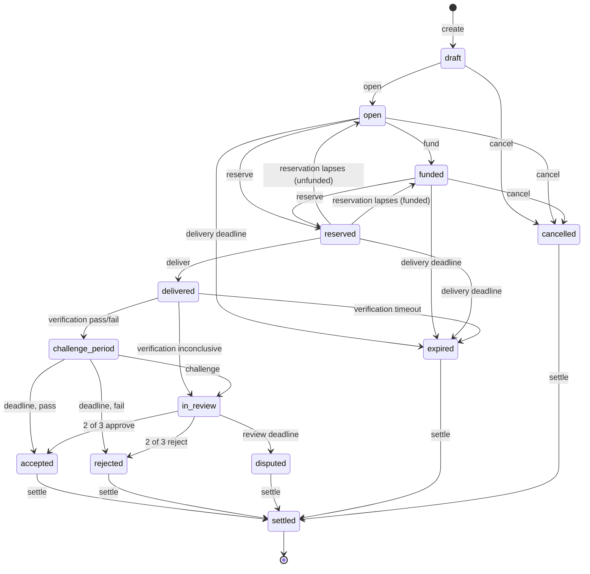

# Request lifecycle

Phase 1, step 1.1. Code: [`core/src/orbit_watch/lifecycle.py`](../core/src/orbit_watch/lifecycle.py).

A request moves through a fixed set of statuses. The rules are a **pure state
machine** ([decision P-05](decisions.md#p-05-pure-state-machine-with-an-injected-clock)):
applying an event returns a new record and never reads a clock, a database or
the network. Time comes from the events, and deadlines are applied at the exact
moment they pass. The same events always give the same record.

Money and points are not handled here. What each outcome pays or refunds comes
with the settlement adapter (step 1.2); how reviewers are chosen comes with
step 1.3.

## Diagram

## Statuses

| Status | Meaning |
|---|---|
| `draft` | Created by the requester; the terms can still change. |
| `open` | Published. The terms are frozen and their SHA-256 is recorded. Stations can reserve. |
| `funded` | Open, with points deposited (optional). |
| `reserved` | One station has reserved the request until the reservation expires. |
| `delivered` | The station delivered an observation file (identified by its SHA-256); automated verification runs. |
| `challenge_period` | The plan's "automatically verified": the automated result is published, and the requester or the observer can challenge it until the deadline. |
| `in_review` | Three reviewers decide; two votes the same way settle it. |
| `accepted`, `rejected`, `disputed` | Outcomes of verification. |
| `expired` | No delivery before the deadline, or automated verification did not finish. |
| `cancelled` | Cancelled by the requester before anyone reserved it. |
| `settled` | Final. Every request ends here, whatever its outcome. |

## Events

| Event | Allowed in | By | Rules |
|---|---|---|---|
| `revise_terms` | draft | requester | Request id and requester cannot change. |
| `open` | draft | requester | Terms must be valid (below); freezes them. |
| `fund` | open | requester | A positive number of points. |
| `reserve` | open, funded | station | Not the requester. Lasts `reservation_hours`, never past the delivery deadline. |
| `deliver` | reserved | the reserving station | The file's SHA-256. |
| `record_verification` | delivered | system | `pass` or `fail` starts the challenge period; `inconclusive` goes straight to three reviewers. |
| `challenge` | challenge_period | requester or observer | Names three different reviewers; none of them may be the requester or the observer. |
| `vote` | in_review | an assigned reviewer | One vote each; two equal votes decide. |
| `cancel` | draft, open, funded | requester | Not after a reservation. |
| `settle` | any outcome | system | Moves to `settled`. |

Every other event in every other status is refused with the error code
`forbidden_in_status`. The tests check all 130 combinations.

## Deadlines

Deadlines move a request on by themselves when `advance(record, now)` is called
(for example by a scheduler). Each is applied at its own time, so calling
`advance` often or rarely gives the same history.

| Status | Deadline | Result |
|---|---|---|
| reserved | reservation expires | back to `open` or `funded`; another station can reserve |
| open, funded, reserved | delivery deadline | `expired` |
| delivered | delivery time + verification timeout | `expired` |
| challenge_period | challenge deadline | `accepted` if the automated result passed, otherwise `rejected` |
| in_review | review deadline | `disputed` (no two-of-three majority) |

A dispute never locks anything: it is settled like any other outcome, by the
dispute rule of the plan (step 1.3).

## Terms

The terms are copied into the request when it opens ([decision P-07](decisions.md#p-07-default-time-limits-fixed-in-the-request-terms))
and hashed; later changes to the defaults never affect an open request.

| Term | Default | Rule |
|---|---|---|
| `request_sha256` | | SHA-256 of the request document (target, window, requirements) |
| `delivery_deadline` | end of the window + 24 h | not before the end of the window |
| `reservation_hours` | 72 | positive |
| `challenge_period_hours` | 24 | positive |
| `review_hours` | 48 | positive |
| `verification_timeout_hours` | 24 | positive |
| `embargo_days` | 0 | 0 to 30 |
| `licence` | CC-BY-4.0 | |
| `verification_method` | orbit-watch-automated-verification 1.0.0 | |

## Not decided yet

- A rejected delivery ends the request. Whether the request should re-open for
  other stations while time is left is an open question for step 1.3.
- Who may challenge is limited to the requester and the observer. Whether
  others (for example other stations) may challenge, and with what bond, is
  an open question of the plan.
